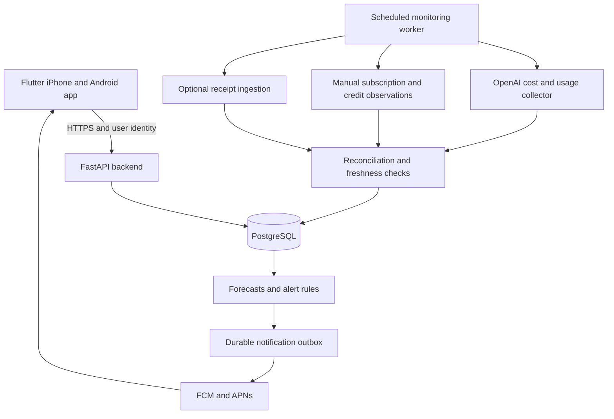

# Implementation architecture

## Current foundation

Version 0.2.0 adds scheduled collection, persistent cost/coverage tables, a durable alert inbox, Mac desktop submission, RBA AUD/USD conversion and collection health. See [operations](operations.md) for the implemented runtime behavior and limitations; the target cloud architecture below remains a future design.

One FastAPI process exposes authenticated JSON endpoints. Python 3.13, HTTPX and Pydantic handle provider calls, decimal values and input validation. A small SQLite repository persists manual records for local development. SQLite stores serialized decimal strings rather than floating-point financial fields.

Provider calls use a separate read-only collector. It retrieves all cost pages before returning a total; a failed or malformed page fails the whole request. Totals remain separated by currency, and provider error bodies are not returned to clients. The collector has no model-generation calls and performs no provider billing mutations.

The app token and optional OpenAI Admin credential come from the backend environment. An absent app token disables financial endpoints. This is a single-user development arrangement, not production identity management. The server should bind to loopback until deployment authentication is implemented.

API surface:

| Method | Path | Purpose |
| --- | --- | --- |
| GET | `/health` | Public process health; does not claim provider health |
| GET | `/v1/providers` | Configured capabilities and limitations |
| GET/POST | `/v1/subscriptions` | List/create manual subscription details |
| PUT/DELETE | `/v1/subscriptions/{id}` | Correct/delete subscription details |
| GET/POST | `/v1/jetbrains/snapshots` | List/save manual quota observations |
| GET | `/v1/openai/costs` | On-demand UTC-day cost query, exclusive end date |
| POST | `/v1/forecasts/recharge` | Estimate threshold time from supplied inputs |
| GET | `/v1/alerts/preview` | Due-today renewal previews; no delivery |
| GET/PUT | `/v1/monitor/settings` | Persist interval, budget, thresholds and delivery preference |
| GET | `/v1/monitor/status` | Collection and scheduler state, freshness and FX status |
| POST | `/v1/monitor/run` | Immediate cost collection, persistence and rule evaluation |
| GET | `/v1/openai/history` | Saved rows, daily totals, coverage and AU$ estimate |
| GET | `/v1/alerts` | Durable spending/monitoring inbox |
| PATCH | `/v1/alerts/{id}/acknowledge` | Acknowledge and suppress pending delivery |
| POST | `/v1/alerts/test` | Exercise the local desktop delivery channel |

The generated OpenAPI schema is the starter client contract. Decimal JSON values are strings. All timestamp inputs must include an offset; provider timestamps and computed forecast times use UTC. Renewal dates are calendar dates interpreted in the configured user timezone. Source timestamps must remain visible to the future dashboard.

## Target architecture

Keep this as one application with a separately supervised worker, not a collection of microservices. PostgreSQL becomes the authoritative store when persistent cost collection and deployment begin. Use migrations from the start of that transition. Supabase Auth is the proposed production identity provider; FastAPI must verify issuer, audience, expiry and user ownership, not merely accept a client-provided user ID.

## Target data model

| Entity | Important distinctions |
| --- | --- |
| users | Timezone, reporting currency and notification preferences |
| billing_accounts | Provider, ownership, external account reference, prepaid/invoiced billing mode |
| subscriptions | Price, original currency, billing channel, cadence, next confirmed renewal |
| usage_cost_observations | Provider interval, grouping dimensions, decimal amount, currency, retrieval time |
| credit_snapshots | Value, unit, observed time, source, reconciliation status |
| credit_purchase_lots | Purchased/remaining credit units and independent expiry dates |
| payment_events | Confirmed vs expected payments; source receipt identifiers |
| rules | Lead time, threshold, severity, version and enabled state |
| forecasts | Basis window, assumptions, confidence, validity and estimated event time |
| notification_events | Stable deduplication key, due time, state and delivery attempts |
| sync_runs | Start/end, last success, error category and data freshness |
| audit_events | Record/credential lifecycle changes without secret values |

Use PostgreSQL NUMERIC for money and credit units, and UTC timestamps for instants. Avoid nullable columns in an upsert key: normalize missing dimensions or use an equivalent explicit uniqueness strategy. Store raw billing observations in access-controlled metadata without unnecessary email content. Distinguish provider corrections from new payments.

## Monitoring and forecasts

Start with a scheduled cost collection every hour and a daily renewal evaluation; these are implementation defaults to tune after measuring provider latency. Re-read an overlapping period to absorb late cost changes, and commit each sync atomically. Serialize work for the same billing account. Use bounded retries with backoff for rate limits and transient failures; permission failures should prompt configuration repair.

Prepaid estimates must start at a known balance snapshot and reconcile consumption, purchases, refunds and expiry since that timestamp. Never subtract an entire calendar month's cost from a midmonth balance. A forecast requires the actual configured recharge threshold and amount; an API budget is a separate rule. Postpaid charge forecasts require a verified billing threshold or billing date rather than an assumption.

The current constant-rate calculation is `(balance - threshold) / average_daily_spend`, based at the observation timestamp. Zero consumption returns no predicted time; an already reached threshold is explicit. Predictions over one year omit a timestamp. This preview does not infer whether automatic recharge is enabled or whether a purchase will succeed.

Production forecasting should compare 7- and 30-day rates using completed time windows, exclude partial days, and show a plausible range. Suppress forecasts for stale observations, insufficient history, reset boundaries or unaccounted purchases. Do not treat credits consumed through JetBrains as a separate OpenAI API charge; BYOK API usage is attributed to its actual provider account.

## Notifications and failure detection

Write notification events and business changes in the same database transaction. A worker claims due outbox rows with a lease, records attempts and uses stable identifiers for provider delivery. An FCM/APNs acceptance is not proof that a phone displayed an alert. Track invalid device tokens and allow users to inspect failed/pending alerts.

Send collection failures only after repeated failures and deduplicate them until recovery. Detect a completely stopped worker using an independent heartbeat check; a stopped worker cannot report its own failure. The deployment must remain online for advance warnings while the Mac and phone are off.

## Deployment decision

The earlier conversation left cloud, Mac mini and hybrid hosting unresolved. Develop locally now. Continuous cloud hosting is the proposed production direction, subject to choosing a host and acceptable recurring cost; no hosting service has been provisioned. A local-only deployment must clearly disclose that monitoring depends on the Mac being awake and connected.

Before phone access or cloud deployment, implement user authentication, HTTPS, secret management, backups and alert delivery. Keep provider Admin keys server-side with restricted access and rotate/revoke them through the provider when necessary. No account or cloud credential has been created by this scaffold.

### v0.7.0 licence separation

`JetBrainsLicence` records keep identity, validity and annual billing apart from quota observations. Snapshots carry a licence ID and nullable monthly reset; summaries filter by identity before forecasting. Alerts namespace receipt keys by licence and select the most urgent newly crossed threshold for each licence. The summary API exposes an array instead of a single combined balance. Manual collection does not require changing IDE authorization. No supported live balance interface has been established; entry remains manual.
